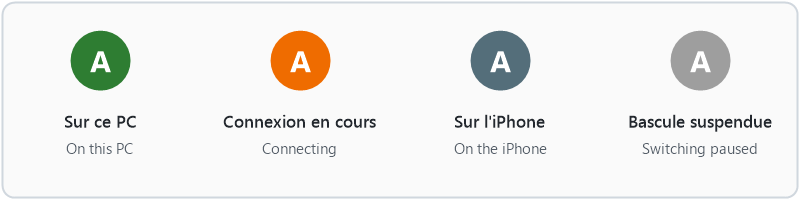

<div align="center">

# 🎧 ACAW
### Auto Connect AirPods Windows

**Your AirPods move from your iPhone to your Windows PC on their own, and back.**


[Français](README.md) · **English**


</div>

> The app itself is in French; this page translates what it does.

---

## Contents

1. [Why ACAW?](#why)
2. [What ACAW does](#what-it-does)
3. [What ACAW cannot do, and why](#limits)
4. [Installation](#installation)
5. [Screenshots](#screenshots)
6. [Building from source](#building)

---

<a id="why"></a>
## Why ACAW?

Between Apple devices, AirPods switch on their own: start a video on your Mac and they leave your iPhone. That
automatic switching goes through your iCloud account, and **Windows is not part of it**.

On a Windows PC, AirPods are just another Bluetooth headset. So, every single time:

- you open the **Bluetooth settings** to connect them to the PC;
- when you are done, you have to **disconnect them by hand**, otherwise your iPhone never gets them back: the
  iPhone does not take AirPods back from a non-Apple device.

ACAW was born out of that frustration, inspired by [PodHop](https://github.com/Mur5h/PodHop), a similar tool for
Linux. It does the switching for you, in the background, from a small icon in the taskbar.

---

<a id="what-it-does"></a>
## What ACAW does

| | |
|---|---|
| ▶️ **The PC plays sound** | The AirPods leave the iPhone and arrive on the PC in **~2 s**. |
| ⏸️ **The PC pauses** | 5 s later, ACAW releases the AirPods: the iPhone takes them back in ~2–3 s. |
| 🔇 **The PC goes quiet** (game, call ended…) | Same, after 30 s of silence. |
| 🔈 **While the AirPods arrive** | The PC speakers are muted: sound never plays out loud in the room. |
| 📱 **The iPhone takes the AirPods**, or you take them off | The PC video pauses instead of carrying on through the speakers. |
| 💼 **AirPods in their case or out of range** | ACAW notices in under 6 s and leaves the sound on the speakers. |
| 💻 **When the PC starts** | Windows sometimes reconnects the AirPods by itself: ACAW hands them straight back to the iPhone. |
| 🎙️ **AirPods microphone** | A menu checkbox turns it on for your calls, and off again to keep switching fast. |

**The taskbar icon** shows where your AirPods are:

| Colour | Meaning |
|---|---|
| 🟢 Green | AirPods on this PC |
| 🟠 Orange | Connecting or releasing |
| 🔵 Blue-grey | AirPods elsewhere (on the iPhone) or idle |
| ⚪ Light grey | Automatic switching paused |

**The menu** (right-click the icon) also lets you **bring the AirPods to this PC** or **give them back to the
iPhone** by hand, pause automatic switching, pick other AirPods and start ACAW with Windows.

ACAW needs **no driver**, **no admin rights** and **no network access**. It only asks Windows to connect or
release the headset, just like a click in the Bluetooth settings would.

---

<a id="limits"></a>
## What ACAW cannot do, and why

### ❌ Pause when you take out one earbud, change the noise-control mode

These features use a protocol specific to Apple, **AAP** (*Apple Accessory Protocol*). AirPods speak it over a
low-level Bluetooth channel (L2CAP), and that is how an iPhone learns that an earbud was removed, or switches
between noise cancellation and transparency.

**The problem is Windows**: a regular application is not allowed to open that kind of channel to a classic
Bluetooth device. Windows does see the AirPods' AAP service, but offers no way to talk to it. That would take a
**driver**, a program running at the core of Windows, and Windows only loads a driver that is **signed by
Microsoft**:

- signing requires a paid company certificate (several hundred euros a year) and approval by Microsoft;
- a workaround exists (Windows "test mode"), but it weakens the PC's security, and game anti-cheat systems
  (Riot Vanguard, for example) refuse to run with it.

The Bluetooth advertisements that AirPods broadcast freely are not enough either: only the earbud that is
broadcasting describes its own state, and the part covering both earbuds is encrypted, with a key that can only
be obtained… through AAP.

**So ACAW deliberately stays driver-free**: it installs in one click, without admin rights, and touches nothing
else in Windows.

### ❌ Let the iPhone take the AirPods back on its own

The iPhone only hands over between Apple devices. So it is always **the PC that releases** the AirPods: when it
pauses, when it goes quiet, or when you click "Rendre à l'iPhone" (give back to the iPhone). If you start music
on the iPhone while the AirPods are on the PC, they stay on the PC until the PC releases them.

### ⚠️ AirPods microphone and slow switching

To use the AirPods microphone, Windows enables an extra Bluetooth profile ("hands-free") that makes each switch
take **10–14 s** instead of ~2 s. ACAW works either way, but it is nicer to keep the microphone off day to day and
tick it only for a call (menu → **Micro des AirPods**).

### ⚠️ Other headsets

ACAW only drives **AirPods** (and, in principle, Beats with an Apple chip). It relies on Apple's own Bluetooth
advertisements to know whether the AirPods are out of their case. It has been tested on AirPods Pro; other
models should behave the same way.

---

<a id="installation"></a>
## Installation

**You need:** Windows 10 or 11 (64-bit), Bluetooth turned on, and your AirPods **paired with the PC** (Settings →
Bluetooth & devices → Add device, case open, case button held until the light turns white).

1. Go to the [**Releases**](../../releases/latest) and download **`acaw-setup-X.Y.Z.exe`**.
2. Run it. Windows may say "Windows protected your PC": the installer is not signed. Click **More info → Run
   anyway**.
3. That's it: ACAW installs without admin rights (.NET included), starts, and will start with Windows. If there is
   only one pair of AirPods, it picks it on its own; otherwise, icon menu → **AirPods**.

**Portable version**: `acaw-X.Y.Z-portable.zip`, unzip it anywhere and run `acaw-tray.exe`. Nothing is installed.

**Uninstall**: Settings → Apps → ACAW → Uninstall.

---

<a id="screenshots"></a>
## Screenshots

<div align="center">

| The menu | A notification |
|:---:|:---:|
|  |  |

**The icon by state**



</div>

---

<a id="building"></a>
## Building from source

You need the [.NET 10 SDK](https://dotnet.microsoft.com/download):

```bash
dotnet build ACAW.sln -c Release
```

The tray application is `src/Acaw.Tray` (`acaw-tray.exe`); `src/Acaw.Cli` provides the `acaw.exe` command line
(`status`, `switch`, `release`, `handsfree on|off`…).
